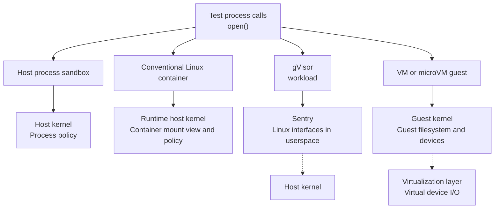

In [Designing Execution Boundaries for Coding Agents](/posts/coding-agent-execution-boundaries/), I looked at what stays shared when a coding agent runs a project from its own Git worktree. In the Docker example, I mounted the worktree at `/workspace` so the agent could run the project in the container and I could review the diff on the host. If a test rewrites a fixture there, the change is still in the host checkout after the container exits.

Say the agent runs `pnpm test`. A test tries to open a fixture and connect to a service on `127.0.0.1`. Both operations raise the same question. Which part of the system decides what the test can reach?

In this article, I'll follow the file read through a host sandbox, a conventional Linux container, gVisor, and a microVM. That gives us a way to compare which component handles the call, which kernel is involved, and how the setup can expose files or services on the host. I'll use that comparison to explain how Codex sandboxes local commands, as one concrete example of this model.

If you don't know what is a host, process, kernel, container, or virtual machine, don't worry. I'll explain those terms in the text.

## Process, kernel, and host

An executable file and a process are not the same thing. The **process** is the execution context created by the operating system: it has an address space, threads, open file descriptors, credentials, resource limits, and a set of kernel-defined capabilities. These elements are not only metadata around the program. They determine whether the process can allocate memory, open a file, create a socket, or start another process.

A process does not usually talk directly to hardware. It makes calls to the operating system, also known as **system calls** or, on platforms with a compatibility layer, equivalent API calls. The kernel receives those calls and mediates them according to the process's identity and policy. When a process calls `open()`, for example, the kernel resolves the path, checks mount and file permissions, and connects the result to a file descriptor in that process. When it creates a network connection, the kernel evaluates the protocol, destination, interface, and network policy.

The **kernel** is the privileged component that executes this mediation. It manages virtual memory, scheduling, devices, filesystems, IPC, and network stacks. A kernel call can satisfy an operation entirely inside the kernel or delegate work to hardware, a virtualized device, or another userspace component. Isolation depends on which kernel an operation reaches and which software is allowed to interpret or forward it.

A process can also create a process tree. A test runner is one process, and the compiler or child command it starts is another. On Unix-like systems, process groups and sessions are OS abstractions that associate related processes with a common terminal, signal, or lifecycle; container runtimes and job managers can use them as part of their setup. Those relationships do not automatically imply isolation. Processes in the same tree can have different credentials or policies, and a parent can usually control a child unless a sandbox or another boundary restricts that relationship.

The **host** is the environment that owns the kernel, hardware, or virtualization layer that starts the process. Its meaning depends on the boundary being discussed. The laptop running `pnpm test` is the host of a host sandbox. The Linux VM running Docker Desktop is the host of a Linux container on macOS. In a virtual machine, the guest operating system has a kernel of its own, while the physical machine and its hypervisor remain the host for the virtualization layer.

These roles separate two different kinds of isolation. A process sandbox usually keeps the process on the host kernel and changes what it is allowed to do. A container can keep the host kernel and change the process's view of it through namespaces and mounts. A virtual machine adds another kernel, and the virtualization layer controls the boundary between guest and host.

## A host sandbox constrains a process in its existing environment

A sandbox is a set of rules attached to a process. The name fits the image: like a sandbox at a playground, it gives an activity a limited area in which to happen without letting every action reach the surroundings.

In software, that means running code, installing dependencies, or testing an error without letting the operation alter the host by mistake. In computing, it does not move the process to a separate machine or replace its operating system. Instead, it restricts what the process can do in the environment where it is already running.

When the test opens a file or tries to connect to a service, the operating system checks that operation against the process's policy. An allowed operation continues normally. A denied operation fails, even though the process is still running on the host. The policy can also apply to subprocesses the test starts.

That keeps the shell, compilers, and SDKs on a developer's laptop available. The policy can allow the test to read libraries and configuration outside the project while limiting its writes to a few directories. A host sandbox narrows what the process can reach; it does not by itself create a second kernel or a fresh copy of the host.

The reverse is possible in a container or microVM. The environment given to the process can contain its own tools and files, while the host exposes only the resources required for the setup. The host still provides or controls the underlying machine, but the process does not need direct access to the host's copy of those tools.

## A Linux container gives the process a different view of the host

In a conventional Linux container, the test makes system calls to the same Linux kernel as the container runtime. The container does not have a separate kernel. Instead, the runtime uses namespaces to give the process a different view of the host: a different mount table, process list, and network interfaces.

This configuration happens at setup time. Mounts connect directories or files from the host into the container, while process and network namespaces create the boundaries for the view. The kernel can also apply seccomp filters to restrict system calls and cgroups to limit CPU, memory, and other resources.

Take the fixture from the opening example. If it lives in a host directory mounted at `/workspace`, the test opens the file through a container path that points to host-backed storage. The mount and file permissions must allow the operation. Mounting a directory also means that a write can reach the host directory; a read-only mount or a copy of the file prevents that, but each setup exposes a different part of the environment.

A service listening on the host's `127.0.0.1` is a separate case. Because the container has its own network namespace, `127.0.0.1` refers to the container's loopback interface, not directly to the host's. The host service becomes reachable only when the runtime or the host provides an explicit route, port, or forwarding rule.

On a Mac, for example, Docker Desktop runs Linux containers inside a Linux VM. The containers share the VM's kernel, not the macOS kernel. Docker Desktop can make macOS directories and ports available across that boundary. To determine where a path or connection leads, check which machine runs the runtime and which resources Docker exposes to it.

## gVisor adds a userspace kernel between the app and the host

**gVisor** is an open-source application kernel written in Go that runs in user space to provide strong sandboxed isolation for containers and AI/agentic workloads.

A conventional container forwards the test's Linux system calls to the host kernel. gVisor introduces another receiver for those calls: a system call interception mechanism redirects them to gVisor, and gVisor decides whether and how to interact with the host kernel.

gVisor central component is the **Sentry**. It implements Linux application interfaces and maintains much of the process state itself: threads, file descriptors, virtual memory, process tables, and network connections. When the test calls `getpid()`, for example, the Sentry can answer from the process model it maintains. When it calls `open()`, the Sentry first resolves the path in the sandbox's virtual filesystem and applies its own access checks.

The Sentry also controls where the operation goes next. It can satisfy a read from memory or another userspace resource, call the host kernel on a restricted path, or delegate filesystem work to a separate process called the **Gofer**. With Directfs enabled, the Gofer exposes host-backed filesystem trees and descriptors that the Sentry can use; without it, the Sentry and Gofer communicate through another filesystem protocol. In both cases, the test still makes the original system call, but the host kernel is no longer the first component to interpret it.

This split creates two policy boundaries. Mounts and filesystem rules determine which host trees the Gofer can expose to the Sentry. The Sentry then decides whether the application can use those trees and which operations are valid in its Linux process model. The host kernel still protects host resources and limits what gVisor itself can request, but it sees a more restricted client than the original test process.

The container runtime can use gVisor as another execution layer while keeping the same container image and OCI-style setup. That changes which component implements Linux interfaces and therefore which application behavior is available. A tool can depend on a syscall, argument, feature, or filesystem operation that gVisor does not implement with identical semantics. Check compatibility and measure high-volume operations: filesystem access, thread creation, and network calls tend to make the extra boundary visible.

## A VM gives the workload a guest kernel and virtual hardware

A virtual machine adds a different software stack below the test. The test still makes `open()` on the guest's operating system, but that operating system runs in a guest context instead of as the physical machine's main system. The guest kernel owns the virtual filesystem and virtual devices presented to the workload. It does not receive the host kernel's mounts, process table, or network interfaces unless the virtualization setup creates and exposes them explicitly.

To perform file-backed I/O, the guest kernel sends a request through the virtual hardware model. The hypervisor or virtual machine monitor receives that request and decides how to implement it on the host. A disk can be backed by a block device, a host file, a remote volume, or another storage system. A network interface can connect to an isolated virtual network or route traffic through NAT and host forwarding. Those choices determine which host resources the guest can reach.

The host, therefore, controls more than the guest kernel. It defines the virtual machine's initial disk, memory, CPU, devices, network, and secrets. It can expose a host directory as a shared filesystem or map a service and credential inside the guest. It can also give the guest a fresh filesystem and deny all host mounts. Isolation is stronger than in a conventional container only when the configuration removes those paths from the guest.

A **microVM** is a virtual machine with a smaller device model and a narrower boot surface. Firecracker, an open source virtualization technology that is purpose-built for creating and managing secure, multi-tenant container and function-based services, uses Linux KVM (Kernel-based Virtual Machine, a virtualization module built directly into the Linux kernel) to execute guest code and a virtual machine monitor written to provide only the devices a workload needs. The guest still has its own kernel, while the Firecracker process on the host manages its lifecycle and virtual devices. The host can restrict that process too, combining host sandbox controls with the guest kernel boundary.

This separation does not make every action safe. A writable host share can carry changes back to the host. A forwarded port can expose a host service. A mounted credential can let the workload authenticate beyond the VM. And the virtualization layer is itself software with an attack surface. The virtual boundary is more useful when the system starts from a small image, exposes the minimum devices and data, and treats networking and credentials as resources that must be allowed explicitly.

The dotted arrows show where a file read can lead to host-side work. The Sentry or the guest can also satisfy a read internally.

## Conclusion

Isolation is not determined only by the technology wrapping the process. It depends on who receives the system call, which kernel interprets it, and which host resources the setup exposes.

A host sandbox can keep the process on the host kernel and restrict its file and network operations. A conventional container adds namespaces and mounts while usually preserving that kernel. gVisor inserts the Sentry and, for some filesystem operations, the Gofer between the application and the host kernel. A microVM adds a guest kernel and requires the virtual devices and virtualization layer to bridge I/O requests.

Start with the resources the workload needs. An SDK, checkout, fixture, package registry, or credential can be allowed directly, mounted, copied, or denied. Ask what remains shared for every one of those resources, including writes and network connections. In the Docker example, mounting the checkout gives the test direct access to the host-backed file; a copy or read-only mount changes what a write can affect.

[How Codex Sandboxes Local Commands](/posts/how-codex-sandboxes-local-commands/) puts this model into practice. It runs `cat` and a network probe under different profiles and shows how changing one filesystem or network rule determines whether the process can reach the resource.

## References

- Michael Bolin. [Inside the Codex sandbox](https://openai.com/index/inside-the-codex-sandbox/). OpenAI engineering article, November 18, 2026.
- Open Container Initiative. [Linux Container Configuration](https://github.com/opencontainers/runtime-spec/blob/v1.3.0/config-linux.md). OCI Runtime Specification, version 1.3.0, published November 4, 2025.
- The Linux Kernel project. [Seccomp BPF (SECure COMPuting with filters)](https://docs.kernel.org/userspace-api/seccomp_filter.html). Linux kernel userspace API documentation.
- Docker. [Docker Engine security](https://docs.docker.com/engine/security/). Docker Engine documentation.
- Docker. [Networking on Docker Desktop](https://docs.docker.com/desktop/features/networking/). Docker Desktop documentation.
- gVisor project. [Introduction to gVisor security](https://gvisor.dev/docs/architecture_guide/intro/). gVisor architecture guide.
- gVisor project. [Filesystem](https://gvisor.dev/docs/user_guide/filesystem/). gVisor user guide.
- gVisor project. [Performance Guide](https://gvisor.dev/docs/architecture_guide/performance/). gVisor architecture guide.
- Alexandru Agache et al. [Firecracker: Lightweight Virtualization for Serverless Applications](https://www.usenix.org/conference/nsdi20/presentation/agache). Published conference paper, 17th USENIX Symposium on Networked Systems Design and Implementation (NSDI '20), February 2020, pp. 419–434.
- Firecracker project. [Firecracker Design](https://github.com/firecracker-microvm/firecracker/blob/main/docs/design.md). Project design documentation.
