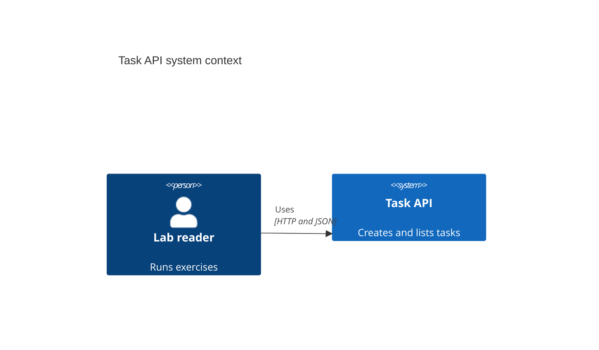

import BookDiagram from "$components/books/BookDiagram.astro";

## Document a behavior you can observe

The epic proposes a labels endpoint. A reader opening your README today needs examples that work on this checkout. Stay on `design-task-labels` from [the epic exercise](/books/hands-on-coding-assistants/chapters/break-down-an-epic/). That branch contains the registration fix and a map of the starter. Check the revision before documenting it.

```sh
git status --short
git log -3 --oneline
npm test
npm run test:registration
npm start
```

In a second terminal, check the initial list and the creation response.

```sh
curl -sSi http://127.0.0.1:3000/tasks
curl -sSi http://127.0.0.1:3000/tasks \
  -H 'Content-Type: application/json' -d '{"title":"  Review the diff  "}'
```

The responses are `200` and `201`. On a fresh server the creation body is `{"id":"2","title":"Review the diff"}`. The first task is already in the array, so the ID starts at two. Stop the server after the checks.

## Give the assistant source material

Use **Plan** with the current revision and the two observed responses.

```text
Read package.json, src/server.ts, src/app.ts, test/app.test.ts, and
notes/repo-map.md. Draft a README API example and two Mermaid C4 views
of this checkout. Cite a path and symbol for every runtime element
and relationship. Use the two responses I supplied. Flag anything
you inferred and return the draft for review.
```

If you see a relationship to a database, find its connection in the code. If the agent lists `PATCH /tasks/:id/labels`, check the router for a handler before giving that example to a reader. Keep proposed endpoints in the RFC.

## Draw the context and then zoom in

A C4 **context** diagram describes the system and its relationship to people or other systems. The reader who uses curl is outside the Task API. The diagram can stop at the HTTP boundary.

<div className="task-api-c4">
<BookDiagram label="Task API system context">



</BookDiagram>
</div>

A C4 **container** is an application or data store. It names a responsibility that runs or holds data inside the system boundary. The Task API has one process. `src/server.ts` listens and `createApp()` routes requests and owns the arrays in that process.

<div className="task-api-c4">
<BookDiagram label="Task API container and HTTP relationship">

```mermaid
C4Container
    title Task API containers
    Person(reader, "Lab reader", "Runs curl")
    System_Boundary(api, "Task API") {
        Container(service, "HTTP service", "Node.js and TypeScript", "Routes JSON requests and keeps state in memory")
    }
    Rel(reader, api, "Uses", "HTTP and JSON")
    UpdateRelStyle(reader, api, $offsetX="50", $offsetY="-26")
```

</BookDiagram>
</div>

Trace each element back to a file or an observation. The first diagram explains who uses the system. In the second, the request crosses the system boundary at the HTTP service, which also owns the state. If the reader needs to understand a rejection, add a small sequence diagram or a short trace from `readObject()` through validation to the response. That view makes the order visible within the process.

## Save documentation for this revision

Put the two Mermaid views into `docs/architecture.md` with the commit you checked. Give each view a caption and explain the direction, data and protocol of each relationship. Add the checked HTTP example to the README. Use Build if you want help applying the draft after review. Inspect the rendered Markdown in your fork. Check that labels remain readable at a narrow width and in both themes. This page shows the same C4 syntax in the book's renderer. Mermaid documents its C4 syntax as experimental, so inspect the SVG when you change a layout.

```sh
git diff -- README.md
git add README.md docs/architecture.md
git diff --cached --check
git diff --cached --stat
git commit -m "Document the running Task API"
```

Keep the as-built views available for the RFC. A proposal can change what the system will do. These diagrams give reviewers a place to start.

## References

- Simon Brown. [System context diagram](https://c4model.com/diagrams/system-context) and [Container diagram](https://c4model.com/diagrams/container). C4 model documentation.
- Mermaid maintainers. [C4 Diagrams](https://mermaid.js.org/syntax/c4.html). Mermaid syntax documentation.
- Node.js contributors. [HTTP](https://nodejs.org/api/http.html). Node.js API reference.
