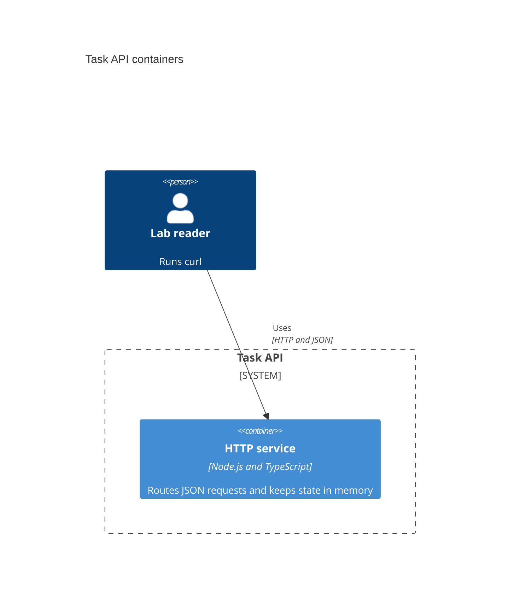

import BookDiagram from "$components/books/BookDiagram.astro";

## Document a behavior you can observe

The epic proposes a labels endpoint. A reader opening your README today needs examples that work on this checkout. Stay on `design-task-labels` from [the epic exercise](/books/hands-on-coding-assistants/chapters/break-down-an-epic/), with the registration fix and your repository map committed. You'll give OpenCode a revision and two responses from the running service, then use those to review what it writes.

```sh
git branch --show-current
git status --short
git rev-parse HEAD
npm test
npm run test:registration
npm start
```

Check that you're on `design-task-labels` with a clean working tree and both suites passing. Save the commit hash printed by Git. In a second terminal, check the initial list and create a task.

```sh
curl -sSi http://127.0.0.1:3000/tasks
curl -sSi http://127.0.0.1:3000/tasks \
  -H 'Content-Type: application/json' -d '{"title":"  Review the diff  "}'
```

On a fresh server the first response is `200` with `[{"id":"1","title":"Write a spec"}]`. The second is `201` with `{"id":"2","title":"Review the diff"}`. The seeded task accounts for the first ID, and the new title comes back trimmed. Keep the status and body of each response for the prompt. Stop the server with Ctrl+C.

## Give the assistant source material

Run `opencode` from the root of your lab fork. Start a fresh session with `/new` if one is already open, select the model from [setup](/books/hands-on-coding-assistants/chapters/setup-and-practical-integration/), and use `/agents` to select **Plan**. Replace the placeholders with your commit hash and the responses you just captured.

```text
I want to document the Task API at <commit hash>.
Read README.md, notes/repo-map.md, package.json, src/server.ts,
src/app.ts, and test/app.test.ts.

Trace npm start to the process that listens for requests. Then trace
GET /tasks and POST /tasks to the handlers and the state they use.
For each finding, give the file and relevant code. Say which parts
are confirmed by the HTTP responses or tests. Return the findings
in chat and leave the files unchanged.

GET /tasks returned <status and JSON body>.
POST /tasks returned <status and JSON body>.
```

Open the files Plan cites. Follow `npm start` from `package.json` to `src/server.ts`, which calls `createApp()` and listens on loopback. In `src/app.ts`, find the arrays inside `createApp()` and follow the read and write paths to the same `tasks` array. Compare the example responses with the actual output you pasted. If the agent names a database, ask it to find the connection in this revision and revise the finding. If it names a labels route, ask it to point to the matching handler and use the routes this checkout serves.

## Draw the context and then zoom in

A C4 **context** diagram shows the system and the people or systems that use it. For the Task API, the reader sending requests with curl is outside the system boundary. A C4 **container** diagram then opens that boundary to show the running applications and data stores inside it. Here the running application is a single Node.js process. The arrays live inside it.

Stay in **Plan** and ask for two drafts based on the evidence you just checked.

```text
Use the findings and HTTP responses we verified. Draft a section
for README.md with the two curl commands and their expected status
and body on a fresh server. Mention when the starter data resets.

Draft docs/architecture.md with the commit hash, a Mermaid C4Context
diagram, and a Mermaid C4Container diagram. Label the direction and
protocol of each relationship, and show where state lives. Add a
short description below each diagram and link to the files that
support the runtime claims. Return both drafts in chat and leave
the files unchanged.
```

Compare the context view with this example. It shows a reader sending HTTP requests to the Task API. The system name stays the same when you zoom in.

<div className="task-api-c4">
<BookDiagram label="Task API system context">


</BookDiagram>
</div>

In the container view, follow the request to the HTTP service. `src/server.ts` starts the listener. `createApp()` provides the request handler and owns the in-memory state in that same process.

<div className="task-api-c4">
<BookDiagram label="Task API container and HTTP relationship">



</BookDiagram>
</div>

Check each box and arrow against the runtime you traced. If a draft draws the listener and router as two processes, send the evidence back to Plan and ask it to revise the container view.

```text
Follow the call to createApp().listen(...) in src/server.ts. Show where
the routing and task arrays live at runtime. Revise the container
diagram and its description to reflect the process you find.
```

Use the same review on the README draft. The order of the two requests matters because the second one changes the list. An example that runs the requests on a server with earlier tasks will get a different ID. Make the fresh-server condition visible beside the commands.

## Save documentation for this revision

When the examples and diagrams match the checkout, switch to **Build** with `/agents` in the same session. It can use the drafts you reviewed.

```text
Apply the approved drafts to README.md and docs/architecture.md.
Keep the existing README setup instructions. Write the diagrams
as fenced mermaid blocks in plain Markdown. Edit only those two
files. Run npm test and npm run test:registration as separate
commands and report the actual results.
```

Open the completed test calls in the session. Expect three starter tests and two registration tests to pass. Run `git status --short` in your own terminal. Expect an edit to `README.md` and a new `docs/architecture.md`. Once the paths match, stage both files so the diff includes the new architecture document.

```sh
git add -- README.md docs/architecture.md
git diff --cached --check
git diff --cached -- README.md docs/architecture.md
```

Read the diff as a developer starting the service for the first time. Open a fresh **Plan** session if you want an independent review of the saved files. Give it a check it can reproduce.

```text
Review README.md and docs/architecture.md against package.json,
src/server.ts, src/app.ts, and test/app.test.ts. Check the commands,
HTTP responses, and each C4 relationship. For any mismatch, give
the doc location, the source evidence, and a proposed correction.
Return findings in chat and leave the files unchanged.
```

Check any finding against the source or repeat the request yourself. If you need an edit, take the finding back to **Build**, then stage and inspect the new diff before committing.

```sh
git commit -m "Document the running Task API"
```

Open the committed Markdown in a preview that supports Mermaid, or view it on your fork after pushing the branch. Check that both diagrams render and that the relationship labels stay readable. Mermaid's C4 syntax is experimental. If your preview reports a parse error, give Build the exact error, the relevant Mermaid block, and the renderer you used. Ask it to correct the syntax while keeping the verified elements and relationships, then render the diagram again.

The [RFC exercise](/books/hands-on-coding-assistants/chapters/write-and-review-an-rfc/) uses `docs/architecture.md` to give reviewers a picture of the current system before they discuss labels.

## References

- OpenCode maintainers. [Agents](https://opencode.ai/docs/agents/) and [TUI](https://opencode.ai/docs/cli/tui/). OpenCode 2 documentation.
- Simon Brown. [System context diagram](https://c4model.com/diagrams/system-context) and [Container diagram](https://c4model.com/diagrams/container). C4 model documentation.
- Mermaid maintainers. [C4 Diagrams](https://mermaid.js.org/syntax/c4.html). Mermaid syntax documentation.
- GitHub. [Creating diagrams](https://docs.github.com/en/get-started/writing-on-github/working-with-advanced-formatting/creating-diagrams). GitHub Docs.
- Node.js contributors. [HTTP](https://nodejs.org/api/http.html). Node.js API reference.
