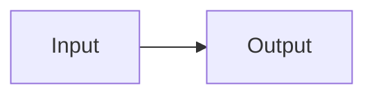

import { YouTube, Excalidraw, LinkCard } from "src/embeds";

## Videos

:youtube[dQw4w9WgXcQ]{#directive-video title="Directive video" playlabel="Play fixture video" params="start=5"}

::youtube[dQw4w9WgXcQ]{#leaf-video title="Leaf video"}

:::youtube{id="dQw4w9WgXcQ" title="Container video"}
:::

https://www.youtube.com/watch?v=dQw4w9WgXcQ

https://youtu.be/dQw4w9WgXcQ

https://www.youtube.com/shorts/dQw4w9WgXcQ

https://www.youtube.com/embed/dQw4w9WgXcQ

<YouTube id="dQw4w9WgXcQ" title="Explicit component" />

## Link cards

:link[https://embed.test/article]{#directive-card title="Custom card title" description="Custom card description" showDescription="true"}

https://embed.test/automatic

- :link[https://embed.test/list]

:link[https://embed.test/unavailable]{#unavailable-card}

:link[https://embed.test/video]{#video-card}

<LinkCard href="https://embed.test/explicit" id="explicit-card" />

## Diagrams

:excalidraw[/src/assets/excalidraw-demo.svg]{alt="Fixture SVG" caption="Diagram caption" .fixture-diagram}

<Excalidraw src="/src/assets/excalidraw-demo.svg" alt="Explicit SVG" />

## Markdown

[Named link](https://embed.test/named)

An inline URL https://embed.test/inline stays in its paragraph.

An inline video https://youtu.be/dQw4w9WgXcQ stays in its paragraph.

Model names gemma3:270m, Llama-3.1:8B, and Qwen-2.5:7B stay intact.

The reference arXiv:2605.20049 and the ratio 1:1 are plain text.

```text
:youtube[dQw4w9WgXcQ]
https://embed.test/code
```

```typescript title="fixture.ts"
const message: string = "renderfixturetoken";
```

| Component | State |
| --- | --- |
| Embed | Rendered |

$$
x^2 + y^2 = z^2
$$


